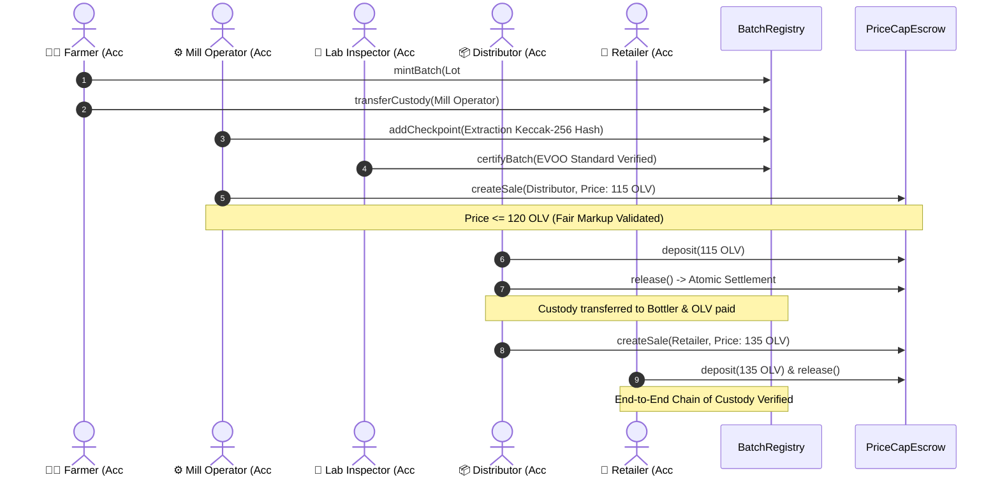

<div align="center">

# 🫒 OliveChain

### **Decentralized Olive Oil Provenance, Lab-Grade Certification & Anti-Speculation Escrow**

*A Next-Generation Web3 Supply Chain Protocol for Mediterranean Extra Virgin Olive Oil (EVOO)*

[](https://soliditylang.org/)
[](https://trufflesuite.com/)
[](https://openzeppelin.com/)
[](https://nextjs.org/)
[](https://www.typescriptlang.org/)
[](https://tailwindcss.com/)
[](https://docs.ethers.org/)
[](https://opensource.org/licenses/MIT)

<p align="center">
  <a href="#-key-features">Features</a> •
  <a href="#-system-architecture">Architecture</a> •
  <a href="#-smart-contracts-overview">Contracts</a> •
  <a href="#-quick-start">Quick Start</a> •
  <a href="#-interactive-demo-flow">Journey Demo</a> •
  <a href="#-documentation">Documentation</a> •
  <a href="#-the-engineering-team">Authors & Credits</a>
</p>

---

</div>

## 📌 Executive Summary

The global Extra Virgin Olive Oil (EVOO) industry suffers from severe fraud, adulteration, mislabeling of origins, and predatory middleman price gouging. 

**OliveChain** is a full-stack decentralized Web3 platform designed to eliminate counterfeit products and market speculation:
- **ERC-721 Physical Digital Twin (`BatchRegistry`)**: Every harvest lot is minted as an on-chain NFT that moves along physical custody checkpoints (Farmer $\rightarrow$ Mill $\rightarrow$ Inspector $\rightarrow$ Bottler $\rightarrow$ Retailer).
- **Cryptographic Lab Verification**: Off-chain laboratory telemetry (acidity %, polyphenol index, peroxide value, UV absorption) is deterministically hashed using Keccak-256 and anchored immutably to on-chain checkpoints.
- **ERC-20 Settlement & Price-Cap Escrow (`PriceCapEscrow` & `OliveCoin`)**: Enforces an anti-inflationary maximum allowable markup percentage at each distribution node, preventing unfair price inflation while providing trustless escrow settlement.

---

## 🌟 Key Features

- 🌿 **Immutable Provenance (NFT)**: Real-world harvest lot lifecycle represented by standard ERC-721 tokens with verifiable custody handovers.
- 🔬 **Laboratory Quality Gate**: Accredited agronomists and lab inspectors review extraction records and append cryptographic certification seals before batches can be sold as certified EVOO.
- 🛡️ **Anti-Speculation Escrow (FT)**: Escrow contract checks current price against historical registered batch price. Transactions exceeding regulatory basis-point margins automatically revert.
- ⚡ **Hash-Anchored Off-Chain Telemetry**: Balances minimal EVM storage costs with cryptographic integrity by anchoring Keccak-256 digests on-chain while serving full lab metrics via a dedicated verification backend.
- 🎭 **Multi-Role Simulation Engine**: Built-in actor switcher with preset identities for Farmer, Mill Operator, Inspector, Distributor, and Retailer, facilitating end-to-end MetaMask simulation.
- 🧭 **Guided Supply Chain Journey**: Interactive 8-step walkthrough in the frontend providing real-time state feedback and role-gated step progression.

---

## 🏛 System Architecture

```
┌────────────────────────────────────────────────────────────────────────────────────────┐
│                                   olive_web (Next.js 16)                               │
│                   TypeScript · Tailwind CSS 4 · Ethers.js v6 · MetaMask                │
│                                                                                        │
│   / (Overview)   /journey (Interactive Demo)   /registry (NFTs)   /market (Escrow/OLV) │
└───────────────────────────┬────────────────────────────────┬───────────────────────────┘
                            │ Read & Transact                │ REST Telemetry & Proofs
                            ▼                                ▼
┌───────────────────────────────────────────────┐ ┌──────────────────────────────────────┐
│        olive_blockchain (EVM / Ganache)       │ │       olive_backend (Node/Express)   │
│                                               │ │                                      │
│  ┌─────────────────────────────────────────┐  │ │  • Keccak-256 Deterministic Verifier │
│  │ BatchRegistry.sol (ERC-721 NFT)         │  │ │  • Off-Chain Laboratory Records      │
│  │ • Custody tracking & handover           │  │ │  • Real-Time Chain Event Indexer     │
│  │ • Append-only quality checkpoints       │  │ │  • Aggregated REST API Service       │
│  │ • Accredited lab certification stamp    │  │ └──────────────────────────────────────┘
│  └────────────────────▲────────────────────┘  │
│                       │ IBatchRegistry        │
│  ┌────────────────────▼────────────────────┐  │
│  │ PriceCapEscrow.sol (Escrow Engine)      │  │
│  │ • Anti-gouging max markup verification  │  │
│  │ • Multi-sig funds deposit & release     │  │
│  │ • Atomic payment & custody settlement   │  │
│  └────────────────────▲────────────────────┘  │
│                       │                        │
│  ┌────────────────────▼────────────────────┐  │
│  │ OliveCoin.sol (ERC-20 "OLV")            │  │
│  │ • Settlement token for trades           │  │
│  └─────────────────────────────────────────┘  │
└───────────────────────────────────────────────┘
```

---

## 📄 Smart Contracts Overview

| Contract | Standard | Primary Responsibility | Key Interfaces / Invariants |
|---|---|---|---|
| [`BatchRegistry.sol`](olive_blockchain/contracts/registry/BatchRegistry.sol) | **ERC-721** | Digital twin of physical olive lot, custody tracker, quality checkpoint ledger. | `mintBatch`, `transferCustody`, `addCheckpoint`, `certifyBatch`, `recordSalePrice` |
| [`PriceCapEscrow.sol`](olive_blockchain/contracts/payment/PriceCapEscrow.sol) | **Custom Escrow** | Anti-speculation escrow engine enforcing maximum percentage markup caps. | `createSale`, `deposit`, `release`, `refund`, `setMaxMarkupBasisPoints` |
| [`OliveCoin.sol`](olive_blockchain/contracts/payment/OliveCoin.sol) | **ERC-20** | Supply chain settlement currency (`OLV`, 18 decimals) with minter authority. | Standard ERC-20 (`transfer`, `approve`, `mint`) |
| [`IBatchRegistry.sol`](olive_blockchain/contracts/interfaces/IBatchRegistry.sol) | **Interface** | Decoupled cross-contract interface between Escrow and Registry. | `getLastPrice`, `isCertified`, `custodianOf`, `recordSalePrice` |

---

## 🚀 Quick Start

### 1. Prerequisites
- **Node.js**: `v18.x` or `v20.x` LTS
- **Ganache**: GUI or CLI (`127.0.0.1:7545`, Network ID: `5777`, Chain ID: `1337`)
- **MetaMask**: Browser Extension

### 2. Smart Contracts Deployment
```bash
# 1. Clone repository
git clone https://github.com/fekikarim/olivechain.git
cd olivechain

# 2. Setup and test contracts
cd olive_blockchain
npm install
npm test              # Executes 49 automated unit & integration tests

# 3. Deploy contracts to local Ganache & sync ABIs
npm run migrate

# 4. (Optional) Run the automated supply-chain simulation script
npm run demo
```

### 3. Backend Oracle Service
```bash
# In a new terminal:
cd ../olive_backend
npm install
npm test              # Run backend verification test suite
npm start             # Starts server on http://localhost:4000
```

### 4. Frontend Decentralized Application
```bash
# In a new terminal:
cd ../olive_web
npm install
npm run dev           # Starts Next.js app on http://localhost:3000
```

---

## 🧭 Interactive Demo Flow (`/journey`)

OliveChain includes a built-in step-by-step interactive simulator available at [`http://localhost:3000/journey`](http://localhost:3000/journey):



---

## 📚 Comprehensive Documentation

Detailed architectural and developer specifications are available in the [`docs/`](docs/) directory:

- 🏛 **[System Architecture & Whitepaper](docs/architecture.md)** — Architectural design, cryptographic anchoring, and security threat modeling.
- 📘 **[Developer & Deployment Guide](docs/deployment-guide.md)** — Comprehensive setup, Ganache configuration, and production build guides.
- 🔌 **[API & Smart Contract Specification](docs/api-specification.md)** — Complete function-level smart contract signatures, events, and backend REST endpoints.
- 🧪 **[Testing & QA Verification](docs/testing-and-qa.md)** — Detailed breakdown of test suites and coverage reports.
- 🗺 **[Project Roadmap & Milestones](ROADMAP.md)** — Completed phases and future engineering milestones.

---

## 👥 The Engineering Team

OliveChain was conceptualized, architected, and engineered by:

<table align="center">
  <tr>
    <td align="center" width="50%">
      <a href="https://github.com/fekikarim">
        <br />
        <sub><b>Karim Feki</b></sub>
      </a><br />
      <p><b>Lead Fungible Token (FT) & Financial Infrastructure Architect</b></p>
      <sub>Full FT Development: ERC-20 OliveCoin & PriceCapEscrow Smart Contracts • Fullstack Architecture (Next.js & Express) • Local Ganache / Truffle Pipeline • MetaMask Integration & Anti-Speculation Math</sub><br/><br/>
      <a href="https://github.com/fekikarim">GitHub: @fekikarim</a>
    </td>
    <td align="center" width="50%">
      <a href="https://github.com/nesrine-derouiche">
        <br />
        <sub><b>Nesrine Derouiche</b></sub>
      </a><br />
      <p><b>Lead Non-Fungible Token (NFT) & Provenance Registry Architect</b></p>
      <sub>Full NFT Development: ERC-721 BatchRegistry Smart Contract • Physical Digital Twin Model • Laboratory Certification Engine • Checkpoint Telemetry Proofs • Ganache / Truffle / MetaMask Integration</sub><br/><br/>
      <a href="https://github.com/nesrine-derouiche">GitHub: @nesrine-derouiche</a>
    </td>
  </tr>
</table>

---

<div align="center">

Made with 🫒 for transparent, unadulterated, and fair Mediterranean agricultural trade.

*Distributed under the MIT License.*

</div>
